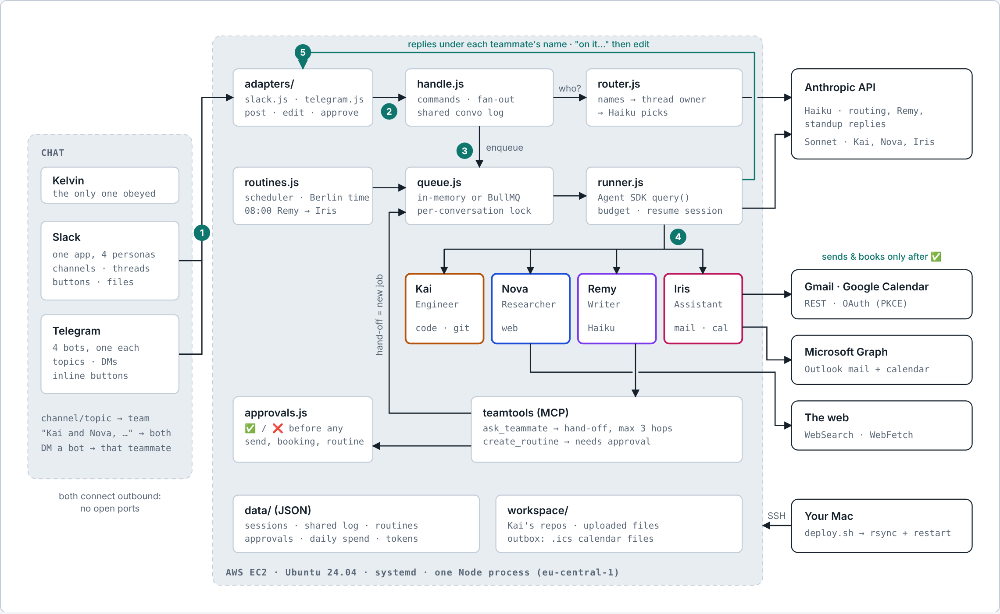

# Agent Team

[](https://github.com/Kellycypher98/agent-teams/actions/workflows/ci.yml)  

**Four Claude agents that work like teammates, reachable from Slack and Telegram.**

I message them the way I'd message coworkers: _"Kai and Nova, should I add 2FA to Aloud?"_ Both answer, each sees what the other said, and they pass work between themselves. Every morning Remy writes an X post, hands it to Iris, and Iris sends it to me to proofread. Nothing is emailed or booked until I tap ✅.

| | Teammate | Does | Runs on |
|---|---|---|---|
| 🛠️ | **Kai**, engineer | Reads, edits and tests code in my repos, pushes a `kai/…` branch and sends me the pull-request link | Sonnet |
| 🔎 | **Nova**, researcher | Searches and reads the web, cites sources | Sonnet |
| ✍️ | **Remy**, writer | Posts, emails, cover letters, the daily X post | Haiku |
| 📅 | **Iris**, assistant | Drafts and sends email from Gmail and Outlook, checks both calendars, books events, makes `.ics` files | Sonnet |



## What it does

- **Talk to one, several or the whole team.** Name someone, name several (`Kai and Nova, …`, `@kai_bot @nova_bot`), or just post in a project channel and a Claude Haiku router picks who fits. Follow-ups stay with the same teammate or group.
- **Teamwork between agents.** An `ask_teammate` tool lets one agent queue work for another with full context: Nova researches, Remy writes it up; Remy drafts, Iris sends. A shared conversation log means the second teammate builds on the first instead of repeating it.
- **Routines.** A scheduler runs multi-step jobs (Remy writes silently → Iris delivers). Agents can propose new routines ("every Friday at 17:00…"), which only start after approval.
- **Human in the loop.** Sending an email, adding a calendar event and creating a routine all show ✅ / ❌ buttons. Each action runs exactly once, exactly as previewed, and expires after 48 h.
- **Files both ways.** Attach PDFs, Word, Excel, images or code; teammates read them. They can send back calendar files and other documents.
- **Two chat apps, one brain.** Slack (one app, four personas) and Telegram (four bots, forum topics, DMs) run side by side on the same memory, routines and budget.
- **Cost controls.** Cheaper models where they're enough, a cap per task, a daily budget, and the cost on every reply.

## Design decisions

- **Platform-agnostic core.** Routing, teamwork, routines and approvals talk to a small adapter interface (`post`, `edit`, `askApproval`, `sendFile`, `dmWhere`, …). Adding Telegram meant writing one adapter, not touching the core.
- **Least privilege per agent.** Every agent gets an explicit tool list and runs in the SDK's `dontAsk` mode, so anything else is refused. Only Iris has mail tools; only Kai has file and shell tools, working in `workspace/` under a non-root service user. A server-side git hook blocks any push to `main` and any branch deletion, so merging stays with me.
- **Email is untrusted input.** Iris is told never to follow instructions inside an email, and even if she were tricked, nothing leaves without my ✅. Attachments are restricted to the workspace (path traversal is tested).
- **Hand-offs are just jobs.** A hand-off goes through the same queue, budget and per-conversation lock as a message, capped at three hops so agents can't bounce work forever.
- **No inbound ports.** Slack Socket Mode and Telegram long polling both connect outward, so the server only exposes SSH from one IP.
- **Boring persistence.** Sessions, conversation logs, approvals, routines and spend are small JSON files with debounced writes. Setting `REDIS_URL` swaps the in-memory queue for BullMQ when it needs to scale.

## Stack

Node.js 22 (ESM) · [Claude Agent SDK](https://docs.claude.com/en/docs/agent-sdk/overview) with in-process MCP tools · Anthropic API · Slack Bolt (Socket Mode) · grammY (Telegram) · Gmail and Google Calendar REST (OAuth with PKCE) · Microsoft Graph (device-code flow) · zod · AWS EC2 + systemd · `node:test` + GitHub Actions

## Quick start

```bash
npm install
cp .env.example .env      # add ANTHROPIC_API_KEY plus Slack and/or Telegram tokens
npm start
```

Full setup (Slack app, Telegram bots, Google and Microsoft auth, AWS deploy, logs, costs): **[docs/SETUP.md](docs/SETUP.md)**.

## Tests

```bash
npm test
```

28 tests run in CI on every push: formatting, routing, ICS generation across daylight-saving changes, MIME encoding, the approval state machine, Gmail/Calendar/Outlook flows against a fake HTTP layer, and end-to-end runs of four Telegram bots against a fake Bot API with the Agent SDK mocked (group replies, hand-offs, the morning routine, approval buttons, ignoring strangers).

## Project structure

```
src/
  bot.js            entry point: starts Slack and/or Telegram, routines, alerts
  handle.js         platform-agnostic message handling: commands, fan-out, routing
  router.js         who should answer: names → current teammate → Claude Haiku
  runner.js         runs a teammate with the Agent SDK: tools, prompt, budget, session resume
  agents.js         the team: role, model, tools, budget, prompt
  channels.js       channel/topic → default team and context
  teamtools.js      ask_teammate and create_routine (in-process MCP server)
  routines.js       scheduler and the built-in morning X post
  approvals.js      ✅ / ❌ store with pluggable executors
  convo.js          shared per-conversation log
  queue.js          in-memory queue (or BullMQ) with per-conversation locks
  spend.js          daily budget and spend report
  files.js          reads attachments (PDF, images, docx, xlsx)
  outbox.js         .ics builder and file sharing tools
  adapters/         slack.js, telegram.js, telegram-format.js
  integrations/     Gmail, Google Calendar, Microsoft Graph, MIME
scripts/            OAuth helpers, syntax check
deploy/             rsync + systemd deploy to EC2, log helpers
test/               node:test suites
docs/               setup guide, architecture diagram, case study
```

## Roadmap

- Turn inbox reading back on for Iris once prompt-injection defenses are tested against real mail.
- Webhooks instead of long polling, and Redis by default, for a multi-instance deploy.
- An eval set for routing and hand-off decisions.

Read the [case study](docs/CASE_STUDY.md) for how it was built and what went wrong along the way.

## License

MIT © Kelvin Osei Boateng
